<div align="center">


# Saarathi

**The AI coordinator that turns a team's group chat into a live project plan.**

Saarathi sits in your team's Telegram group (and Slack and Microsoft Teams), reads ordinary conversation, and turns it into tasks,
owners, deadlines and dependencies. It then follows up with each person, records blockers, asks whoever can unblock them, joins
meetings, and forecasts whether the project will finish on time.

Built for worcflow.ai **PS-1 (Agentic AI track)**, Kurukshetra Hackathon 2026.

 
 
 


</div>

> *Saarathi* is Sanskrit for charioteer: the one who keeps the chariot on course so everyone else can do the work.

---

## Contents

1. [The problem](#1-the-problem)
2. [What Saarathi does](#2-what-saarathi-does)
3. [Demo](#3-demo)
4. [High-level design (HLD)](#4-high-level-design-hld)
5. [Low-level design (LLD)](#5-low-level-design-lld)
6. [Data flow diagrams](#6-data-flow-diagrams)
7. [UML diagrams](#7-uml-diagrams)
8. [Tech stack](#8-tech-stack)
9. [Repository layout](#9-repository-layout)
10. [Getting started](#10-getting-started)
11. [Configuration](#11-configuration)
12. [API reference](#12-api-reference)
13. [Testing and quality](#13-testing-and-quality)
14. [Deployment](#14-deployment)
15. [Security](#15-security)
16. [Observability](#16-observability)
17. [Scalability and cost](#17-scalability-and-cost)
18. [GitHub PRD ingestion and PR review](#18-github-prd-ingestion-and-pr-review)
19. [How the project was built (PR history)](#19-how-the-project-was-built-pr-history)
20. [Roadmap](#20-roadmap)
21. [Team](#21-team)

---

## 1. The problem

Group projects rarely fail from lack of skill. They fail from lost information:

- Work is agreed in chat ("Tejas we need the website by the 20th") and then forgotten, because nobody copies it into a tracker.
- Nobody knows who is blocked on whom until the deadline has already slipped.
- Status meetings repeat the same questions, and the decisions made in them are not written down.
- Whoever chases people for updates spends their week nagging instead of building.

Trackers like Jira or Notion only work if people update them, and student teams don't.

## 2. What Saarathi does

| Capability | What happens |
| --- | --- |
| **Chat becomes tasks** | "Soham please finish the login page by Friday, after the API is done" creates a task with an owner, a deadline and a dependency. Nobody types commands or tags the bot. |
| **Asked by** | Records who asked for each task, drawn as its own colour in the graph. |
| **Smart check-ins** | Messages each owner on the app they prefer (Telegram, Slack or Teams) before deadlines, with one-tap buttons. |
| **Understands replies** | "stuck, waiting for the Figma file from Soham" marks the task **Blocked**, records the blocker and asks Soham directly. |
| **Three-stage reasoning** | Rules (instant), then **Jev** (typed decisions in milliseconds), then an **LLM** only when Jev is unsure, behind a safety gate written in plain code. |
| **Undo everything** | Every change is an append-only event with the quoted message, the engine, its confidence and a snapshot to undo it. |
| **Official meetings** | "Group meeting in 20 minutes" is scheduled with a Cancel button and a reminder 5 minutes before it starts. "Anyone up for chai?" is ignored. |
| **Meeting bot** | Joins Teams, Zoom or Meet calls through Recall.ai (or reads an uploaded transcript), picks out updates, blockers and decisions, and posts a summary. |
| **Forecast and risk** | A CP-SAT scheduler plans every open task over the dependency graph, predicts the finish date and flags deadline risk before it happens. |
| **Autonomous follow-ups** | A policy-checked planner decides whom to contact and why (request an ETA, remind, escalate), with anti-spam rules. |
| **Graph database** | Mirrors people, tasks, ownership, requests and dependencies into Neo4j and shows them as an interactive graph. |
| **Live dashboard** | Board, table, forecast, graph, meetings, activity, team and connections, updated live over Server-Sent Events. |

## 3. Demo

### Landing page

| Flow graph and headline | Try it in the browser |
| --- | --- |
|  |  |

### Dashboard

| Task board, updated from chat replies | A task's full history, with the engine and Undo |
| --- | --- |
|  |  |

| Forecast: CP-SAT schedule, risks, critical path | Interactive graph: hover to trace, click for details |
| --- | --- |
|  |  |

| Meetings: invite the bot or upload a transcript | Activity: every message and every change |
| --- | --- |
|  |  |

| Team and preferred apps | Connections: which apps and models are live |
| --- | --- |
|  |  |

### The demo script

1. Add tasks the natural way. In the Telegram group, Atharva writes *"Tejas we need a fully functioning website by the 20th"*, and Saarathi replies *"New task T3 … for @Tejas, due Tue 20 Oct"* with an **Undo** button.
2. Press **Send check-ins**. Each person's phone buzzes on their own app.
3. Tejas replies *"stuck, waiting for the Figma file from Soham"*. The task turns **Blocked**, Soham is asked for the file, and the forecast marks the website **at risk**.
4. Soham says *"group meeting in 20 minutes"*. Saarathi schedules it, and the group gets a reminder at T−5 and at the start.
5. Send the bot into the call (or upload the `.vtt`). The summary, decisions and action items appear on the Meetings page and in Slack.
6. Soham taps **Sorted**, Tejas replies *"done, deployed, PR #14"*, and the task is **Complete** with proof attached.
7. Open the task to see the quoted messages, which engine decided, its confidence, the full trace, and Undo.

---

## 4. High-level design (HLD)

### 4.1 System context

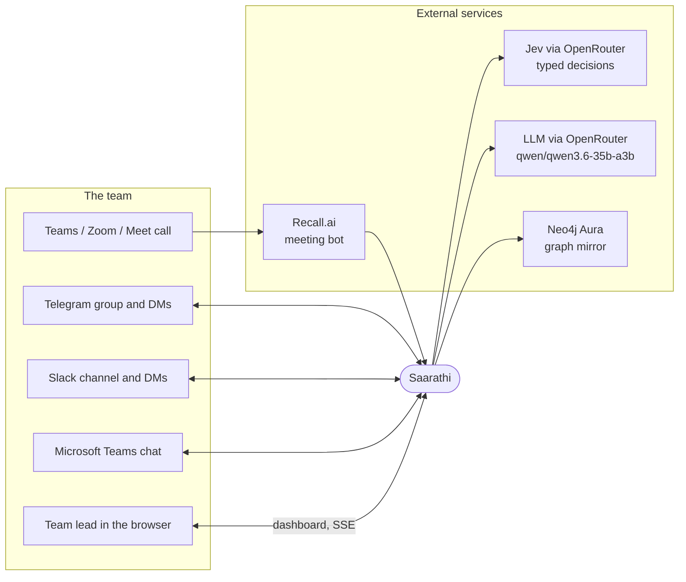

### 4.2 Container architecture (production on AWS)

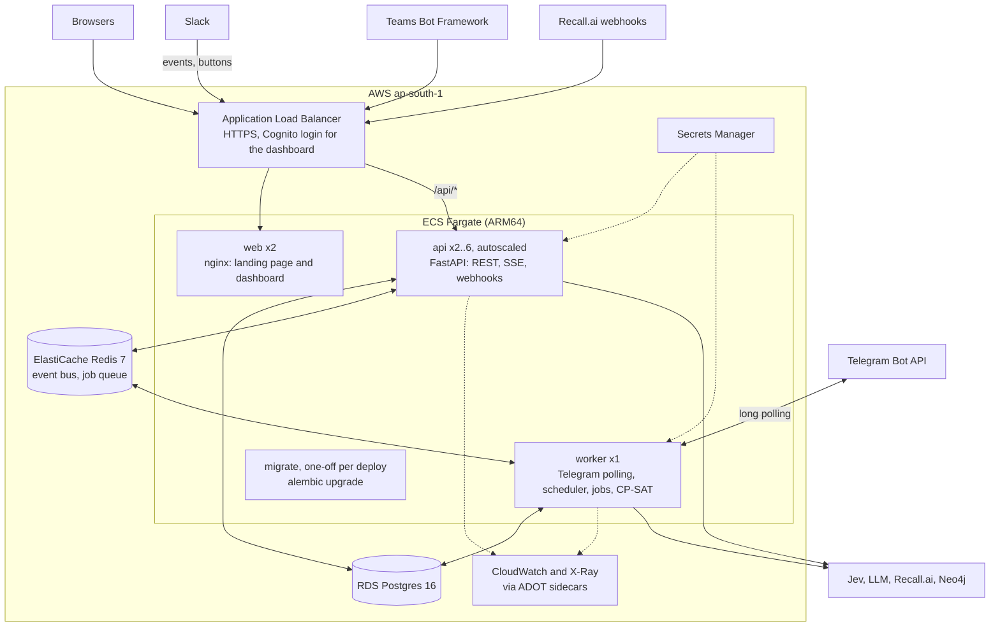

**Why two processes.** The API scales out because it is stateless. The worker runs exactly once so that only one Telegram poller and one scheduler exist (two pollers would make Telegram drop updates). They share state through Postgres and fan out live updates through Redis pub/sub, so a change made by the worker reaches every API replica's SSE clients.

### 4.3 Core loop

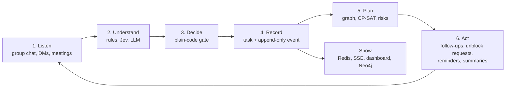

---

## 5. Low-level design (LLD)

### 5.1 Backend modules

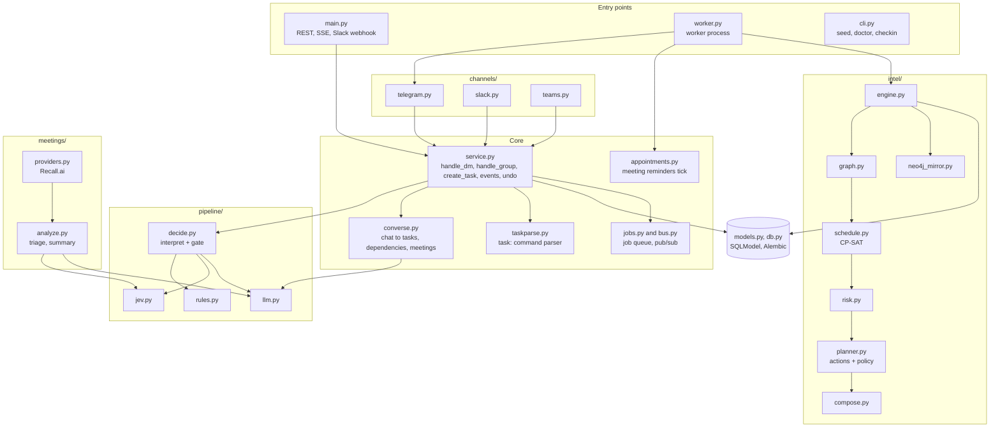

### 5.2 Message understanding pipeline (`pipeline/decide.py`)

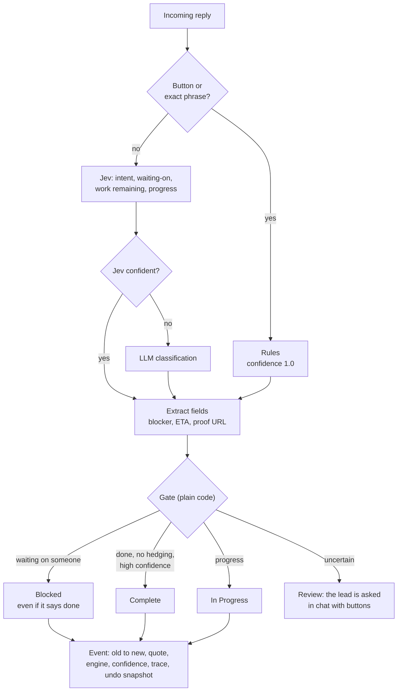

### 5.3 Conversation to tasks (`converse.py`)

Every group message is read once. The model proposes **tasks**, **dependencies**, **status reports** or a **meeting**. Code then validates each proposal before anything is written:

| Check | Rule |
| --- | --- |
| Real people | Owner resolved from a name, `@username` or "I'll do it" (the speaker) |
| Real tasks | Dependencies must point at existing tasks or ones created in the same message |
| No loops | A dependency that would create a cycle is refused |
| Dates | Never in the past; "by Friday", "the 20th", "kal tak" become dates |
| No duplicates | Same title and owner, or a meeting within ±10 minutes, is skipped |
| Confidence | Nothing below `AUTO_TASK_MIN_CONFIDENCE` |
| Official meetings | `official` must be true and the start 1 minute to 30 days away; social plans are ignored |

### 5.4 Scheduling intelligence (`intel/`)

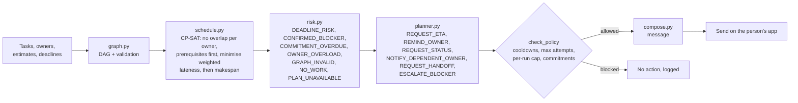

The agent reasons from the task graph, never from the LLM, and keeps working if the solver fails (`PLAN_UNAVAILABLE` falls back to rules). The full model and the 20 failure cases it handles are in [docs/INTELLIGENCE.md](docs/INTELLIGENCE.md).

### 5.5 Frontend

| Page | Route | What it shows |
| --- | --- | --- |
| Landing | `/` | Animated flow graph, workflow at a glance, an in-browser message parser preview, "Get started" |
| Project tasks | `/dashboard/#/tasks` | Board and table, new task, link dependencies, side panel with history and Undo |
| Forecast and agent | `#/forecast` | CP-SAT result, projected finish, risks, dependency graph, schedule, agent actions |
| Graph database | `#/graph` | Interactive Neo4j graph: hover to trace links, filter chips, zoom, details panel |
| Meetings | `#/meetings` | Upcoming team meetings, invite the bot, upload a transcript, summaries |
| Activity | `#/activity` | Every message in and out and every status change |
| Team | `#/team` | Members, linked apps, preferred channel |
| Connections | `#/integrations` | Which apps and models are connected |

Two Vite entry points (`index.html` and `dashboard/index.html`) build one static bundle. React Bits animations (BlurText, CountUp) via `motion`. Live updates arrive over `EventSource('/api/stream')`.

---

## 6. Data flow diagrams

### 6.1 Level 0 (context)

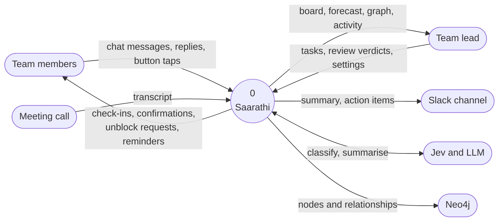

### 6.2 Level 1 (inside Saarathi)

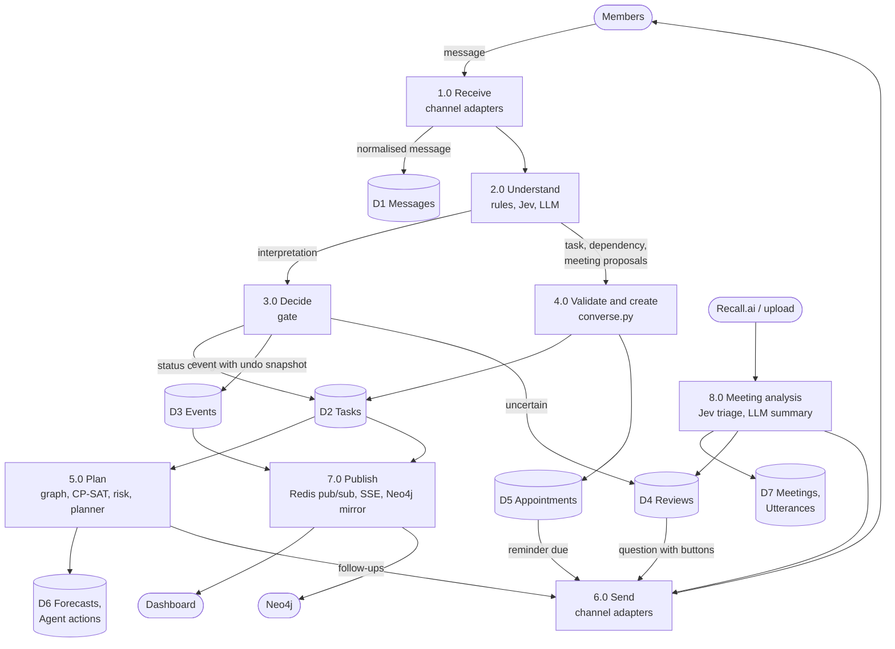

---

## 7. UML diagrams

### 7.1 Class diagram (data model, `backend/app/models.py`)

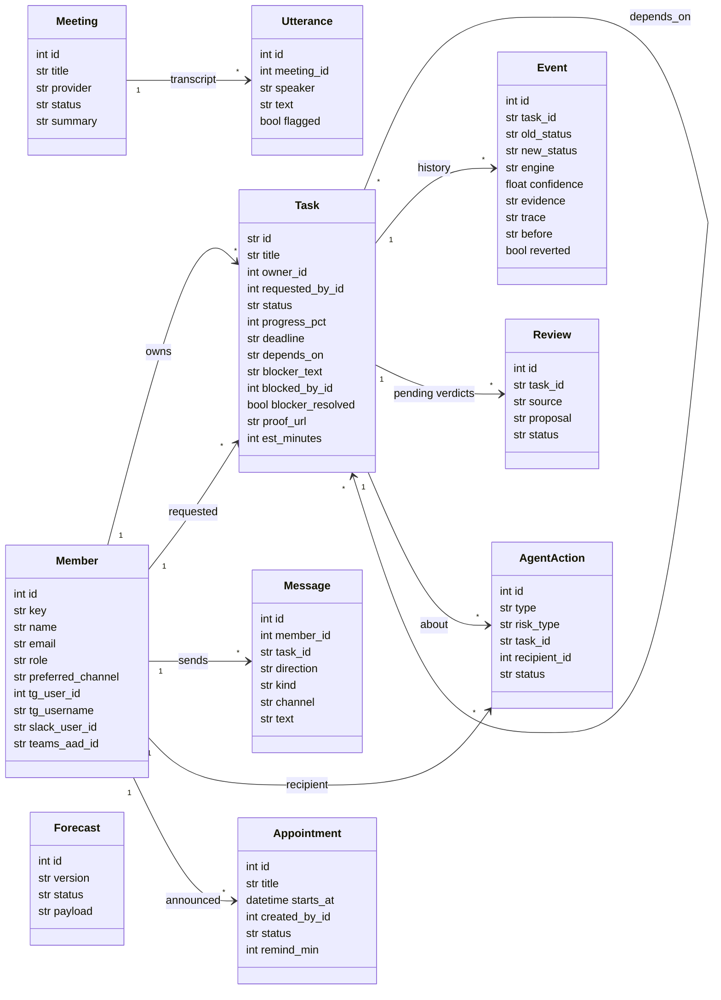

### 7.2 Task state machine

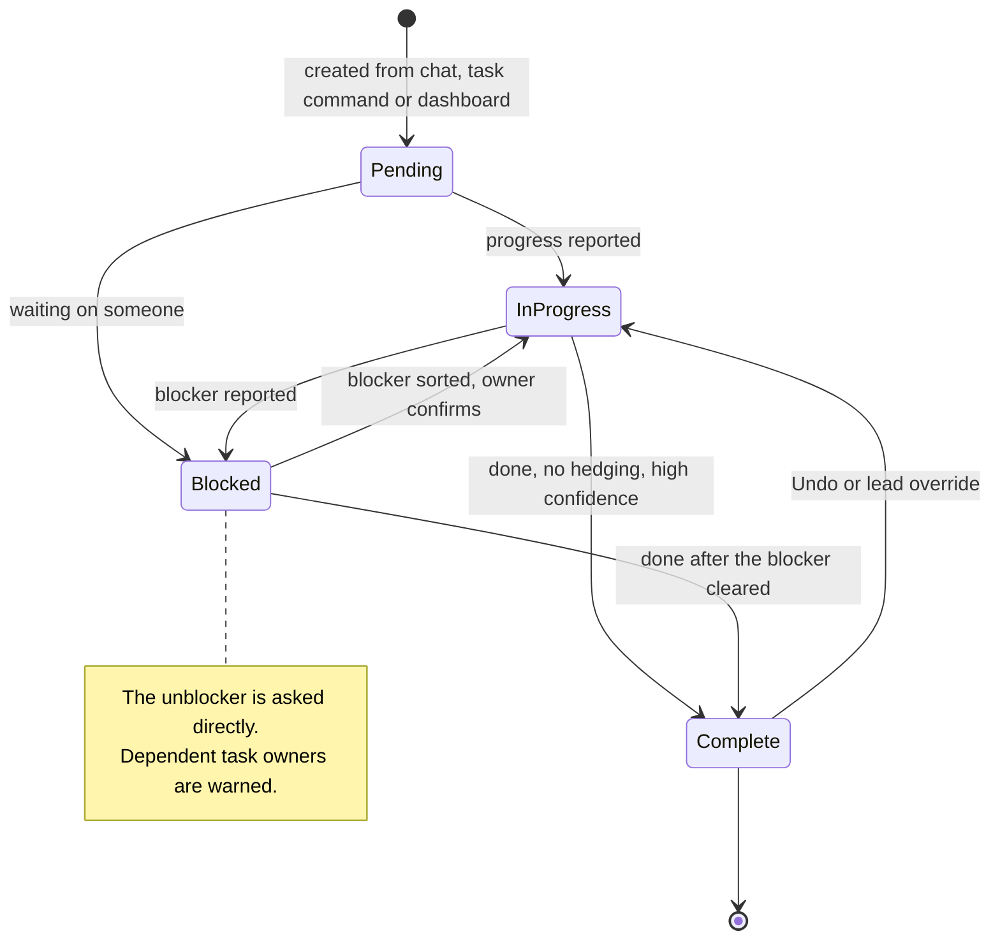

### 7.3 Sequence: a check-in and a blocked reply

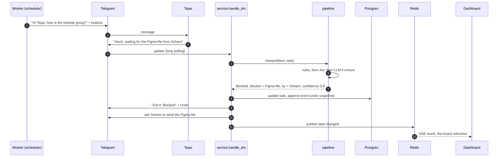

### 7.4 Sequence: group chat to task and meeting

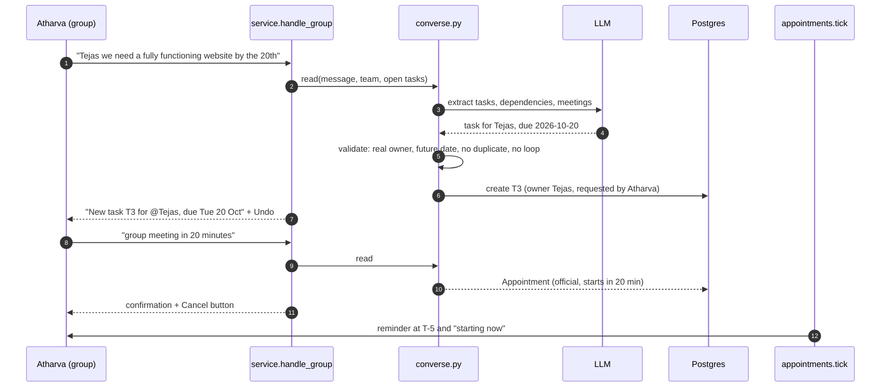

### 7.5 Sequence: meeting analysis

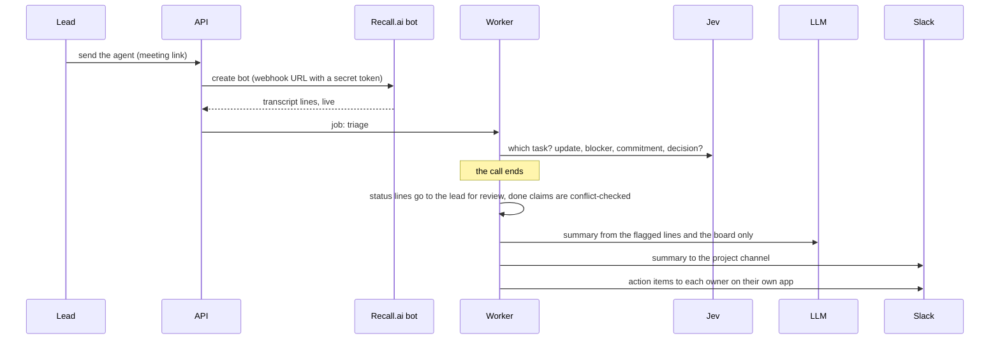

### 7.6 Entity relationships

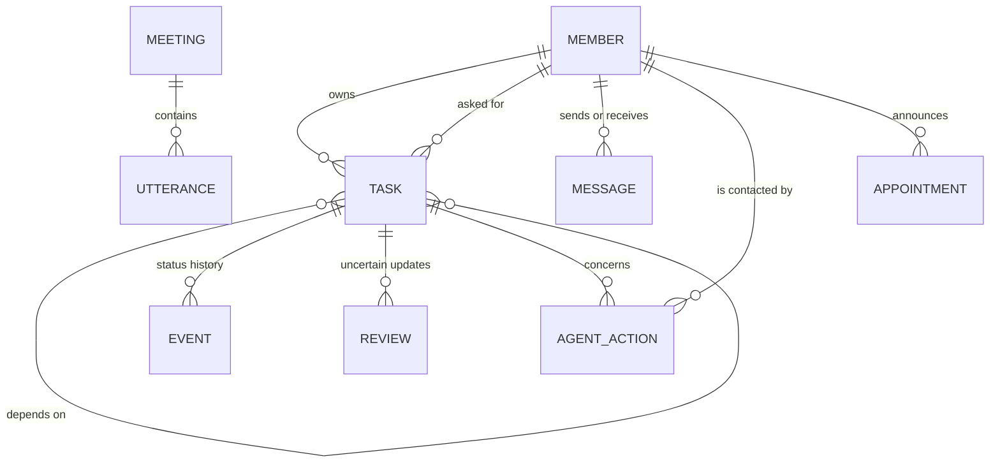

In Neo4j the same data becomes `(:Project)-[:HAS_TASK]->(:Task)`, `(:Person)-[:OWNS]->(:Task)`, `(:Person)-[:REQUESTED]->(:Task)` and `(:Task)-[:DEPENDS_ON]->(:Task)`.

---

## 8. Tech stack

| Layer | Technology |
| --- | --- |
| API | Python 3.11+, FastAPI, Uvicorn, Pydantic, Server-Sent Events |
| Data | SQLModel / SQLAlchemy, Alembic migrations, SQLite (dev) or Postgres 16 (prod) |
| Messaging | Redis pub/sub and job queue (fakeredis in tests) |
| Channels | python-telegram-bot, Slack Bolt (Socket Mode or HTTP), Microsoft Teams SDK |
| Understanding | Rules, **Jev** typed decisions via OpenRouter, LLM via an OpenAI-compatible API (OpenRouter `qwen/qwen3.6-35b-a3b`) |
| Planning | Google OR-Tools **CP-SAT** |
| Graph | Neo4j (Aura), read-only mirror |
| Meetings | Recall.ai, or WebVTT upload |
| Frontend | React 19, TypeScript, Vite, `motion` (React Bits), Vitest + Testing Library |
| Observability | OpenTelemetry → X-Ray and CloudWatch (prod) or Grafana LGTM (local) |
| Infrastructure | Docker, docker-compose, Terraform, ECS Fargate, RDS, ElastiCache, ALB + Cognito, ECR, Secrets Manager |
| CI/CD | GitHub Actions: ruff, pytest, Alembic check on Postgres, npm build, terraform validate, OIDC deploy to ECS |

## 9. Repository layout

```
.
├── backend/
│   ├── app/
│   │   ├── main.py            REST + SSE + Slack webhook (FastAPI)
│   │   ├── worker.py          worker process: Telegram polling, scheduler, jobs
│   │   ├── service.py         the coordinator: DMs, group chat, tasks, events, undo
│   │   ├── converse.py        group chat → tasks, dependencies, meetings
│   │   ├── appointments.py    meeting reminders
│   │   ├── pipeline/          rules, Jev, LLM, decide (interpret + gate)
│   │   ├── channels/          Telegram, Slack, Teams adapters
│   │   ├── intel/             graph, CP-SAT schedule, risk, planner, Neo4j mirror
│   │   ├── meetings/          Recall.ai provider, transcript triage and summary
│   │   ├── doctor.py          checks every integration and prints the fix
│   │   └── models.py, db.py   data model and sessions
│   ├── migrations/            Alembic
│   ├── scripts/               end-to-end simulators (chat and Recall)
│   └── tests/                 pytest suite
├── frontend/
│   ├── index.html             landing page entry
│   ├── dashboard/index.html   dashboard entry
│   └── src/
│       ├── landing/           landing page, flow graph, message preview
│       ├── pages/             Tasks, Forecast, Network (graph), Meetings, Workspace
│       └── components/        Logo, React Bits animations
├── deploy/
│   ├── terraform/             AWS infrastructure
│   ├── compose/               local gateway (stands in for the ALB)
│   └── slack-manifest.yaml, teams-manifest/
├── docs/                      ARCHITECTURE, INTELLIGENCE, INTEGRATIONS, TESTING, DEPLOY_AWS, OBSERVABILITY, images/
├── .github/workflows/         ci.yml, deploy.yml
└── docker-compose.yml         production-shaped local stack
```

---

## 10. Getting started

### Prerequisites

Python 3.11+, Node 20+. Docker is optional, for the production-shaped stack.

### Run locally

```bash
# backend
cd backend
python -m venv .venv && source .venv/bin/activate        # Windows: .venv\Scripts\activate
pip install -r requirements.txt -r requirements-dev.txt
cp .env.example .env                                      # tokens are optional
alembic upgrade head && python -m app.cli seed            # team from data/team.csv
uvicorn app.main:app --reload --port 8000

# frontend (second terminal)
cd frontend
npm install
npm run dev        # landing page http://localhost:5173, dashboard http://localhost:5173/dashboard/
```

With no keys at all, the rules engine runs, and the sidebar's **Test without apps** panel lets you play the scenario as any team member. It is hidden when `APP_ENV=prod`.

### Run the production-shaped stack

```bash
cp backend/.env.example backend/.env
docker compose up --build
```

The app is at http://localhost:8080 behind a gateway that routes like the AWS load balancer: two API replicas, one worker, Postgres, Redis, and Grafana with traces and metrics at http://localhost:3000.

### Check every connection

```bash
cd backend && python -m app.cli doctor
```

`doctor` checks Telegram (token, webhook, privacy mode, group), Slack (token, scopes, whether events ever arrived), who is reachable on which app, Neo4j, Jev, the LLM and Recall, and prints the exact fix for each problem. Step-by-step testing: [docs/TESTING.md](docs/TESTING.md).

---

## 11. Configuration

All settings are environment variables (`backend/.env` in development, Secrets Manager on AWS). Every integration is optional: leave its key empty and it switches off.

| Area | Variables |
| --- | --- |
| Runtime | `APP_ENV` (dev/prod), `ROLE` (all/api/worker), `PUBLIC_BASE_URL`, `FRONTEND_ORIGIN`, `DATABASE_URL`, `REDIS_URL` |
| Telegram | `TELEGRAM_BOT_TOKEN`, `LEAD_TELEGRAM_ID`, `TELEGRAM_GROUP_CHAT_ID` (learned automatically) |
| Slack | `SLACK_BOT_TOKEN`, `SLACK_SIGNING_SECRET`, `SLACK_APP_TOKEN` (Socket Mode), `SLACK_PROJECT_CHANNEL`, `SLACK_SUMMARY_CHANNEL`, `SLACK_ALERT_CHANNEL` |
| Teams | `TEAMS_CLIENT_ID`, `TEAMS_CLIENT_SECRET`, `TEAMS_TENANT_ID` |
| Meetings | `RECALL_API_KEY`, `RECALL_REGION`, `RECALL_BOT_NAME`, `WEBHOOK_TOKEN`, `MEETING_AUTO_APPLY` |
| Jev | `OPENROUTER_API_KEY`, `JEV_URL`, `JEV_MODEL`, `JEV_MIN_CONFIDENCE`, `JEV_CONCURRENCY` |
| LLM | `LLM_BASE_URL`, `LLM_API_KEY`, `LLM_MODEL`, `LLM_FALLBACK_MODEL` |
| Decisions | `MODE`, `AUTO_APPLY_CONFIDENCE`, `COMPLETE_CONFIDENCE`, `FOLLOWUP_INTERVAL_MIN`, `STALE_AFTER_MIN` |
| Chat to tasks | `AUTO_TASKS`, `AUTO_TASK_MIN_CONFIDENCE` |
| Intelligence | `INTEL_AUTORUN`, `INTEL_DEBOUNCE_S`, `INTEL_SOLVER_TIME_S`, `INTEL_DEFAULT_TASK_MIN`, `INTEL_COOLDOWN_MIN`, `INTEL_MIN_GAP_MIN`, `INTEL_MAX_ATTEMPTS`, `INTEL_MAX_ACTIONS_PER_RUN`, `INTEL_COMMIT_GRACE_MIN`, `INTEL_UNKNOWN_UNBLOCK_MIN` |
| Neo4j | `NEO4J_URI`, `NEO4J_USER`, `NEO4J_PASSWORD`, `NEO4J_DATABASE` |
| Observability | `LOG_JSON`, `OTEL_EXPORTER_OTLP_ENDPOINT`, `OTEL_SERVICE_NAME` |

How to create each bot and token: [docs/INTEGRATIONS.md](docs/INTEGRATIONS.md).

## 12. API reference

Interactive OpenAPI docs are served at `/docs` when the backend runs.

| Method | Path | Purpose |
| --- | --- | --- |
| GET | `/api/health`, `/api/ready` | Liveness, and readiness (database and Redis) |
| GET | `/api/board` | Tasks, members, counts |
| POST | `/api/tasks` | Create a task (`owner_key`, `deadline`, `est_minutes`, `depends_on`, `requested_by_key`) |
| DELETE | `/api/tasks/{id}` | Delete a task and its history |
| POST, DELETE | `/api/tasks/{id}/dependencies[/{dep}]` | Add or remove a prerequisite (cycles refused) |
| POST | `/api/tasks/infer-dependencies` | Link obvious prerequisites |
| GET | `/api/tasks/{id}/timeline` | Messages and events for one task |
| GET | `/api/activity` | Everything that happened, newest first |
| GET, POST | `/api/reviews`, `/api/reviews/{id}/resolve` | Uncertain updates and the lead's verdict |
| POST | `/api/checkin` | Send check-ins now |
| POST | `/api/events/{id}/undo` | Undo a change |
| GET, POST | `/api/team`, `/api/team/{key}/preferred` | Members and their preferred app |
| GET, DELETE | `/api/appointments[/{id}]` | Upcoming team meetings, cancel one |
| GET, POST | `/api/meetings`, `/api/meetings/upload`, `/api/meetings/{id}/finish` | Meeting bot, transcripts, summaries |
| GET, POST | `/api/intel/forecast`, `/graph`, `/network`, `/actions`, `/replan` | Forecast, dependency graph, Neo4j network, agent actions, replan |
| GET | `/api/stream` | Server-Sent Events for live updates |
| POST | `/api/slack/events`, `/api/teams/messages`, `/api/meetings/webhooks/recall` | Webhooks (signature- or token-verified) |
| POST | `/api/dev/message`, `/api/dev/button`, `/api/reset` | Development only, disabled in prod |

## 13. Testing and quality

| Suite | Command | Covers |
| --- | --- | --- |
| Backend (512 tests) | `cd backend && pytest -q` | Labelled replies, the Jev contract, the full blocker loop, channel routing, Slack/Teams rendering, chat to tasks, official meetings and reminders, meeting triage to summary, HTTP contract, graph → CP-SAT → risk → action → Telegram |
| Live Neo4j (opt-in) | `pytest tests/test_neo4j_live.py` | Real Aura round trip, skipped without credentials |
| Frontend (116 tests) | `cd frontend && npm test` | Landing page, dashboard pages, graph interactions, API client |
| Simulators | `python scripts/simulate.py`, `python scripts/simulate_recall.py` | End-to-end conversations (75 scenarios) and meeting flows (25) |
| Lint and types | `ruff check app tests`, `npx tsc -b` | Style and type safety |

CI runs all of this on every push, plus `alembic upgrade` and `alembic check` against a real Postgres and `terraform validate`.

---

## 14. Deployment

### AWS (production)

`deploy/terraform` creates the whole environment in `ap-south-1` (Mumbai): VPC, ALB with HTTPS and a Cognito login, ECS Fargate on Graviton, RDS Postgres, ElastiCache Redis, ECR, Secrets Manager, CloudWatch alarms and dashboard, and an OIDC role for GitHub Actions (no AWS keys stored in GitHub).

```
push to main
  CI      ruff, pytest, alembic on Postgres, npm build, terraform validate
  Deploy  build arm64 images → ECR (tag = commit SHA)
          run the migration task (stop if it fails)
          roll api, worker and web; the circuit breaker rolls back a failing release
```

The API and web roll with zero downtime. The worker stops and then starts, so two Telegram pollers never overlap. Full guide: [docs/DEPLOY_AWS.md](docs/DEPLOY_AWS.md).

### Render (backend, single instance)

`render.yaml` is a Render Blueprint for the backend: one Docker web service that runs the API and the worker loops in one process (`ROLE=all`) and applies migrations on start (`MIGRATE_ON_START=true`). Create the service from the Blueprint, or set these in an existing service under **Settings → Build & Deploy**:

| Setting | Value |
| --- | --- |
| Dockerfile Path | `./backend/Dockerfile` |
| Docker Build Context Directory | `./backend` |
| Health Check Path | `/api/health` |

Then add the environment variables. `DATABASE_URL` should point at a Postgres (Render or Neon; their `postgres://` URLs work as-is), because SQLite on Render is wiped on every deploy and restart. Set `FRONTEND_ORIGIN` to the Vercel URL, `PUBLIC_BASE_URL` to the Render URL, and add the integration keys you use. On the free plan the service sleeps when idle. While it sleeps, Telegram polling, scheduled check-ins and reminders pause, and the first request takes about 50 seconds.

### Vercel (frontend only)

Set the root directory to `frontend`, the build command to `npm run build` and the output directory to `dist`. The landing page is fully static. The dashboard calls `/api/...`, so add a rewrite from `/api/(.*)` to the backend's public URL and set `FRONTEND_ORIGIN` on the backend to the Vercel domain.

## 15. Security

- **Secrets** live only in environment variables or Secrets Manager. `.env` is gitignored, and Terraform ignores secret values after creation so tokens never sit in state.
- **Webhooks** verify the Slack signing secret, the Teams Bot Framework token, and a random `WEBHOOK_TOKEN` in Recall URLs.
- **Dashboard login** through Cognito at the load balancer in production. Webhook paths stay public because they verify signatures.
- **Network isolation:** tasks and databases run in private subnets with no public IPs. RDS and Redis are encrypted at rest and in transit.
- **Least privilege:** GitHub deploys through a short-lived OIDC role. Images are scanned on push and tagged immutably.
- **Safe AI:** the LLM never writes to the board directly. Every proposal passes code checks (real people, real tasks, no loops, no past dates), uncertain updates go to the lead, and every change can be undone.
- **Development tools off in production:** `/api/dev/*`, `/api/reset` and the test panel are disabled when `APP_ENV=prod`.

## 16. Observability

Structured JSON logs, OpenTelemetry traces across FastAPI, httpx, SQLAlchemy and Redis, and metrics. Locally they go to Grafana LGTM, and on AWS to X-Ray and CloudWatch through ADOT sidecars. CloudWatch alarms email through SNS: API 5xx and p95 latency, unhealthy targets, worker not running, application errors, model failures, RDS CPU and free storage, and Redis memory. Details: [docs/OBSERVABILITY.md](docs/OBSERVABILITY.md).

## 17. Scalability and cost

**Scaling model.** The API is stateless and autoscales from 2 to 6 tasks on CPU and request count. The worker is a deliberate singleton for Telegram polling and scheduling. Postgres and Redis scale vertically, and Multi-AZ is one variable.

**Estimated capacity at the default size (not load-tested):** hundreds of teams, a few thousand users. A team of four produces a few hundred messages a day, so the first limits are:

| Limit | Where | Mitigation |
| --- | --- | --- |
| One worker | Telegram polling, scheduler, CP-SAT | Shard teams across bots and workers; move Telegram to webhooks on the API |
| Telegram API | ~30 messages/s per bot, ~20/min per group | Built-in rate limiter; more bots |
| LLM and Jev rate limits | Every group message is read once | Rules first, Jev before the LLM, per-run caps |
| `db.t4g.micro` connections | ~80 connections | One-variable instance upgrade |

**Monthly cost (estimate, ap-south-1).** The full Terraform stack costs about **USD 110–150**, mostly NAT gateway, load balancer and Fargate. A single small EC2 or Lightsail instance running `docker-compose.yml` costs about **USD 10–20** and comfortably serves a hackathon-scale deployment. External services: the OpenRouter LLM (a few dollars at this volume), Recall.ai (per meeting hour), Neo4j Aura (free tier). Check the AWS Pricing Calculator before relying on these numbers.

---

## 18. GitHub PRD ingestion and PR review

In the configured Telegram project group, a linked team lead can attach a Markdown or plain-text PRD with the `/prd` caption, reply to a supported file with `/prd`, or send `/prd <GitHub blob URL>`. The bot limits uploaded PRDs to 1 MiB of UTF-8 text and accepts only allowlisted GitHub repositories configured through `GITHUB_ALLOWED_REPOS`. Private repository reads require the optional `GITHUB_READ_TOKEN`, which should be a fine-grained token with only read-only Contents and Pull requests access. The bot does not use local `gh` credentials.

The PRD extractor proposes tasks, deadlines, estimates, explicit roster owners, and prerequisites. It auto-creates only items with supporting evidence, confidence of at least 0.90, no duplicate, and an unambiguous roster owner. Unassigned or uncertain work and invalid, ambiguous, cyclic, or held dependencies are reported for the lead instead of guessed. It does not infer member skills or availability. Existing project tasks are created through the normal task service and sent through each owner's linked channel.

For pull requests, use `/reviewpr <allowlisted PR URL>` or explicitly ask in Telegram to review a PR and include its URL. The bot retrieves PR metadata, changed-file patches and GitHub checks and returns a bounded read-only summary in Telegram. It never posts a GitHub review or comment, approves, requests changes, merges, checks out code, executes repository content, or pushes changes. See [docs/INTEGRATIONS.md](docs/INTEGRATIONS.md) for setup and [docs/TESTING.md](docs/TESTING.md) for the offline verification flow.

## 19. How the project was built (PR history)

The project was built in ten reviewable steps, each a pull request stacked on the previous one, and then a product and UI pass.

| Step | Branch | PRs | What it added |
| --- | --- | --- | --- |
| 1 | `step-01-backend-foundation` | #1, #11 | Config, data model, Alembic migrations, team roster |
| 2 | `step-02-message-pipeline` | #2, #12 | Message understanding: rules, Jev and LLM classification, the decision gate |
| 3 | `step-03-coordinator-service-api` | #3, #13 | Coordinator service, REST API, runtime and CLI |
| 4 | `step-04-frontend-dashboard` | #4, #14 | React dashboard: tasks, workspace, live activity |
| 5 | `step-05-channels` | #5, #15 | Telegram group, Slack and Teams channels |
| 6 | `step-06-meeting-bot` | #6, #16 | Recall.ai meeting bot, transcripts and analysis |
| 7 | `step-07-scheduling-intelligence` | #7, #18 | CP-SAT scheduling, risk, autonomous follow-ups, Neo4j |
| 8 | `step-08-tasks-from-conversation` | #8, #17 | Tasks and dependencies from natural conversation |
| 9 | `step-09-official-meetings` | #9, #19 | Official meeting announcements and reminders |
| 10 | `step-10-ops-docs-ci` | #10 | Doctor, simulations, deployment, CI and docs |
| UI | `saarathi-ui-refresh` | #20 | Saarathi brand and logo, landing page, cream dashboard, interactive graph, "asked by" edges, React Bits, emoji removal |

Steps 1–9 were merged twice (#1–#9, then #11–#19) after the stacked branches were re-based onto `main`.

## 19. Roadmap

- **HashiCorp Vault** for credentials (load secrets into the environment at startup, AWS IAM login on ECS).
- Telegram webhooks on the API instead of polling, to remove the single-worker limit.
- Microsoft Graph transcript polling as a second meeting source.
- A multi-team mode, with one workspace per project.
- AWS WAF on the load balancer, and one NAT gateway per availability zone.

## 20. Team

| Name | Role |
| --- | --- |
| Tejas | Lead |
| Soham | Member |
| Samarth | Member |
| Atharva | Member |

---

<div align="center">
<sub>Saarathi keeps group projects on course.</sub>
</div>
